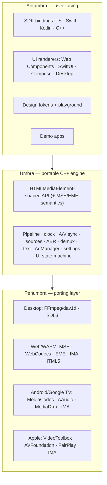

# Alumbra

> *alumbrar* (Spanish): to illuminate.

**Alumbra is a portable media player engine written in C++ that exposes an HTML5-shaped
(`HTMLMediaElement`) API on every platform** — Web, Android & Google TV, iOS, iPadOS & tvOS, and
desktop (macOS & Linux). It is inspired by the architecture of YouTube's living-room runtime
([Cobalt](https://github.com/youtube/cobalt) and its Starboard porting layer) and by
[VLC](https://www.videolan.org/)'s philosophy that *any* media you can point at should play.

Alumbra is **a player, not a platform**: no CMS, no backend, no accounts. Paste a URL, press play.

> **Status: planning.** The project is being designed in the open. Every significant decision is
> debated in a [definition issue](https://github.com/LuisAhumadaMartens/alumbra/issues?q=label%3Atype%3Adefinition)
> and recorded as an [Architecture Decision Record](docs/adr/). Follow progress on the
> [roadmap](docs/roadmap.md) and the [project board](https://github.com/users/LuisAhumadaMartens/projects).

## Goals

| Area | Target |
|------|--------|
| Streaming | Progressive (MP4, TS, MKV/WebM), **HLS**, **DASH**, **LL-HLS**, **LL-DASH**; native `rtmp`, `rtsp`, `srt`, `udp` |
| Codecs | H.264/AVC, H.265/HEVC, VP9, AV1 · AAC, Opus, AC-3/E-AC-3, FLAC, MP3 · HDR10/HLG |
| Text | WebVTT, SubRip (`.srt`), ASS/SSA, TTML/IMSC1, CEA-608/708 |
| Ads | Google **IMA** (client-side VAST/VMAP), **DAI/SSAI**, **SGAI** (HLS interstitials); built-in VAST 4/VMAP on desktop; Open Measurement–safe overlays |
| DRM | ClearKey/CENC → Widevine, FairPlay, PlayReady through each platform's native path |
| Platforms | Desktop (macOS, Linux) → Web → Android & Google TV → iOS, iPadOS & tvOS |
| UI | One design source of truth (design tokens) + shared headless UI logic + native renderers; styled fullscreen, including during ads |
| Settings | Every tunable lives in **one settings schema**, generated for every language and documented automatically |

## Architecture

Alumbra is organised in three layers, named after the regions of a shadow — from the hidden core
outwards to where light becomes visible:

| Layer | Role | Analogy |
|-------|------|---------|
| **Umbra** | Platform-agnostic C++20 engine. Knows nothing about any OS. | Cobalt's media stack |
| **Penumbra** | Porting layer: decoders, renderers, audio sinks, networking, DRM, ad SDK bridges. | Cobalt's Starboard |
| **Antumbra** | Everything a user or integrator touches: SDKs, UI, demo apps, design tokens. | The app |

Read more in [docs/architecture/overview.md](docs/architecture/overview.md).

## Documentation

- [Vision & non-goals](docs/vision.md)
- [Glossary](docs/glossary.md) — including the *SubRip* vs *Secure Reliable Transport* "SRT" collision
- [Architecture overview](docs/architecture/overview.md)
- [Roadmap](docs/roadmap.md) and [compatibility matrix](docs/compatibility.md)
- [Architecture Decision Records](docs/adr/)
- [Research notes](docs/research/) — Cobalt/Starboard, iOS fullscreen & IMA, SSAI/SGAI, low latency
- [How we work](docs/process.md) — definitions, ADRs, labels and the board

## Building

There is nothing to build yet. Milestone **M0 · Foundations** introduces the C++20 / CMake presets /
vcpkg toolchain ([ADR-0009](docs/adr/0009-toolchain.md)).

## Contributing

See [CONTRIBUTING.md](CONTRIBUTING.md). Design discussions happen in issues labelled
[`type:definition`](https://github.com/LuisAhumadaMartens/alumbra/issues?q=label%3Atype%3Adefinition).

## License

[Apache License 2.0](LICENSE). Third-party components keep their own licenses; see
[ADR-0010](docs/adr/0010-license-and-visibility.md) for the dependency licensing policy.
