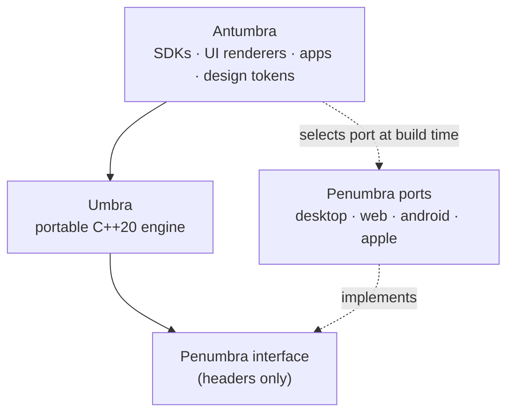
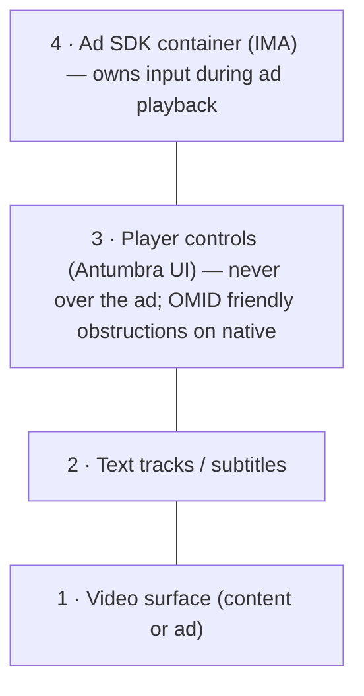
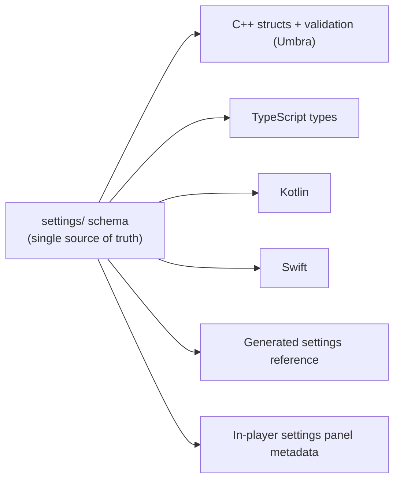
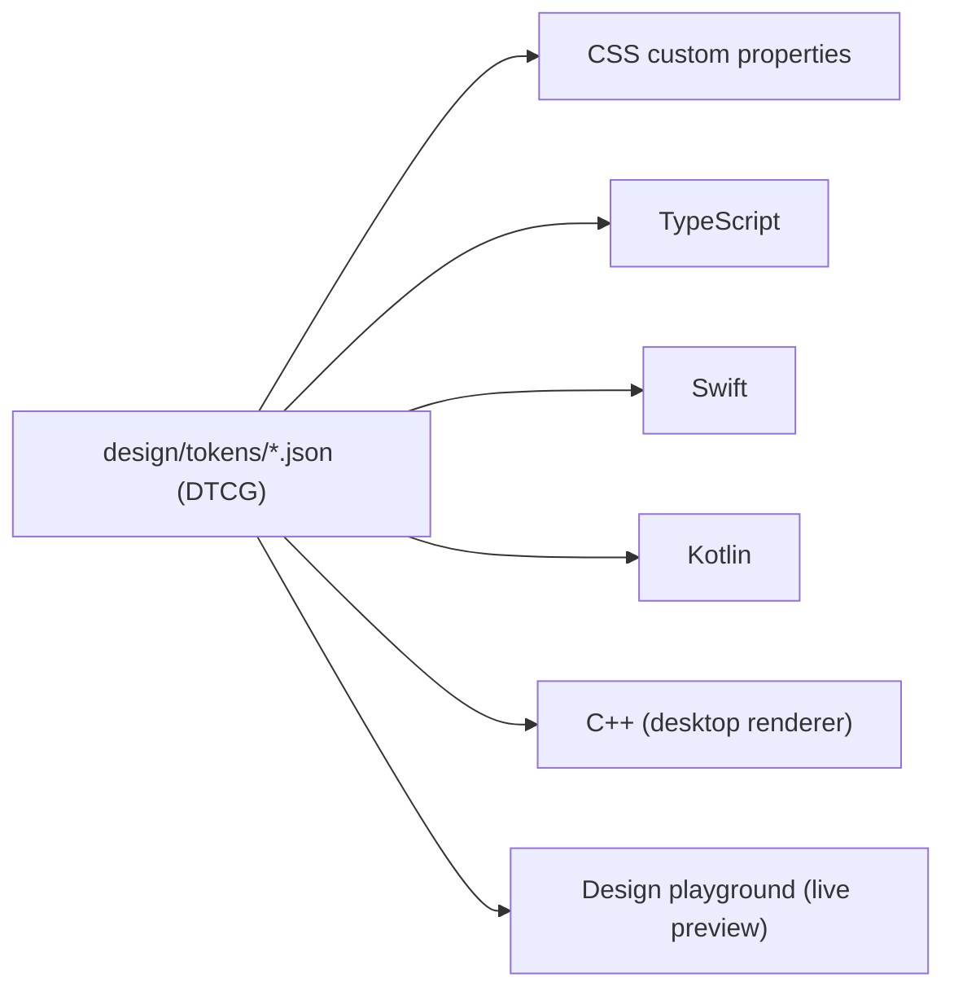

# Architecture overview

> This document describes the **intended** architecture. Statements marked *(open: D-NN)* are still being
> debated in the matching [definition issue](../process.md#definitions); they change only through an ADR.

## 1. Layers and the dependency rule



1. **Umbra depends only on the Penumbra *interface*,** never on a port. It contains no OS, browser or vendor
   header. This is enforced in the build (separate CMake targets) and by the [layering checks](layering.md),
   which run in CTest and CI.
2. **Ports depend on the Penumbra interface and their platform,** never on each other. The layering checks
   enforce this for includes and links.
3. **Antumbra depends on Umbra's public API** and wires a port in at build time.
4. **Ad SDKs and DRM CDMs live in ports,** because they are platform SDKs (there is no C++ IMA SDK and CDMs are
   closed); Umbra talks to them through provider interfaces.

### Public headers

Only headers under a module's `include/` directory are installed, and they are the public API that embedders and
ports compile against. They use **the C++20 standard library and other installed Alumbra headers only**: no
Abseil and no internal engine header, so embedders do not compile against Abseil headers or see engine
internals. Linking the installed static libraries still requires the exact Abseil release used by the producer:
release-specific `absl::lts_*` symbols are an ABI dependency. The exported package records the detected
producer version and requires it with `find_dependency(absl <version> EXACT CONFIG)`. If configuration rejects
an installed release, set `absl_DIR` to that exact release's CMake package directory or rebuild Alumbra with the
consumer's Abseil release. Internal engine headers (for example the task runners in `umbra/base/internal_include/`) are visible
inside the build but not installed. Abseil and `Threads::Threads` remain link-only dependencies of the installed
static libraries. The installed-consumer test enforces the rule: it scans every installed header's includes and
compiles each header alone at exactly C++20, and `alumbra_installed_consumer_rejects_abseil_header` proves that a
header including Abseil is rejected. `alumbra_installed_consumer_rejects_abseil_version` proves that a
mismatched library release is rejected during configuration, before compilation or linking.

The [C++ API reference](https://luisahumadamartens.github.io/alumbra/api/cpp/) documents every installed
header. It is generated from the headers and the Markdown sidecars in
[`docs/api/cpp/`](https://github.com/LuisAhumadaMartens/alumbra/tree/main/docs/api/cpp), never from source
comments, and CI fails when a public symbol lacks documentation or an entry no longer matches a declaration
([ADR-0022](../adr/0022-documentation-site-and-api-reference.md)).

## 2. Umbra — the engine

| Module | Responsibility |
|--------|----------------|
| `umbra::base` | Task runners, sequences, thread pool, single-thread executor, weak pointers and tick clocks ([threading](threading.md), [ADR-0015](../adr/0015-threading-and-task-runners.md)); bounds-checked byte and bit readers for every parser ([readers](byte-readers.md)) |
| `umbra::api` | `HTMLMediaElement`-shaped public API: attributes, methods, events, `MediaError` *(open: D-03)* |
| `umbra::pipeline` | Playback state machine, master clock, A/V sync, seeking, rate control *(open: D-01, D-02)* |
| `umbra::source` | Source resolution from a typed URL; progressive, HLS, DASH, low-latency variants, `rtmp`/`rtsp`/`srt`/`udp` *(open: D-14)* |
| `umbra::manifest` | Unified presentation model shared by HLS and DASH *(open: D-10)* |
| `umbra::abr` | Bandwidth estimation and rendition selection *(open: D-11)* |
| `umbra::buffer` | Forward/back buffer management and memory budgets *(open: D-12)* |
| `umbra::demux` | MP4/fMP4/CMAF, MPEG-TS, WebM/Matroska demuxers *(open: D-05)* |
| `umbra::text` | Text track parsing (WebVTT, SubRip, ASS/SSA, TTML/IMSC1, CEA-608/708) and cue model *(open: D-15)* |
| `umbra::ads` | AdManager: break scheduling, cue points (VMAP, SCTE-35, `EXT-X-DATERANGE`), timeline mapping, providers, OMID obstruction registry *(open: D-23…D-26)* |
| `umbra::drm` | EME-shaped `MediaKeys`/`MediaKeySession` model and CENC metadata; ClearKey implementation *(open: D-27)* |
| `umbra::settings` | Runtime for the single settings schema: defaults, validation, precedence, change notifications ([ADR-0017](../adr/0017-settings-schema-and-configuration.md)) |
| `umbra::ui` | Headless UI state machine: what is visible, focus/D-pad navigation, ad mode, menus *(open: D-28)* |
| `umbra::observability` | Logging, tracing, QoE metrics and debug overlay data ([ADR-0020](../adr/0020-observability-logging-tracing-qoe-metrics.md)) |

## 3. Penumbra — the porting contract

Penumbra is deliberately small. A port implements, at most:

| Interface | Desktop | Web (WASM) | Android / Google TV | iOS / iPadOS / tvOS |
|-----------|---------|------------|---------------------|---------------------|
| Video decode + render | FFmpeg / dav1d + SDL3 GPU | MSE `<video>` or WebCodecs + WebGL | MediaCodec + Surface | VideoToolbox + `AVSampleBufferDisplayLayer` *(open: D-20)* |
| Audio decode + sink | FFmpeg + SDL3 audio | MSE or WebCodecs + Web Audio | MediaCodec + AAudio | AudioToolbox + `AVSampleBufferAudioRenderer` |
| Networking | libcurl | `fetch` | platform HTTP stack | `NSURLSession` *(open: D-08)* |
| DRM | ClearKey | EME | MediaDrm (Widevine) | FairPlay (`AVContentKeySession`) |
| Ads provider | built-in VAST/VMAP (in Umbra) | IMA HTML5 | IMA Android | IMA iOS / tvOS |
| Capability query | static + probe | `MediaSource.isTypeSupported`, `VideoDecoder.isConfigSupported` | `MediaCodecList` | `VTIsHardwareDecodeSupported` |

The shape of the contract is decided in [ADR-0016](../adr/0016-penumbra-port-contract.md): a push-model player
expressed as C++ interfaces, with a shared reference player built from decoders and sinks. Prior art is
summarised in [research/cobalt-and-starboard.md](../research/cobalt-and-starboard.md). The time, sample and
stream types that cross the contract are described in [media types](media-types.md).
The [v1 port contract reference](port-contract.md) describes the abstract player, component and platform-hook
interfaces, their non-installed Abseil boundary, callback generations and per-call ownership/thread/error rules.
The [decoder chain](decoder-chain.md) describes how the shared reference player selects decoders and falls back.

## 4. Antumbra — what users touch

- **SDKs:** TypeScript (`<alumbra-player>` web component + typed API), Kotlin, Swift, and the C++ API itself
  *(open: D-18)*.
- **UI renderers:** thin, platform-native views (Web Components, Jetpack Compose, SwiftUI, a desktop renderer
  *(open: D-19)*) that draw what `umbra::ui` tells them to, styled exclusively by design tokens.
- **Design tokens:** W3C Design Tokens (DTCG) JSON in [`design/tokens`](../../design/), generated into CSS,
  TypeScript, Swift, Kotlin and C++ ([generated outputs](../../design/README.md#generated-outputs)), and
  previewed live in the design playground ([ADR-0019](../adr/0019-design-tokens.md)).
- **Demo apps:** `alumbra` desktop CLI/GUI, the web demo (GitHub Pages), Android/Google TV and iOS/tvOS apps.

## 5. Playback data flow (adaptive stream)

```mermaid
sequenceDiagram
  participant App as Antumbra (app/SDK)
  participant API as umbra::api
  participant Src as umbra::source + manifest
  participant ABR as umbra::abr + buffer
  participant Dmx as umbra::demux
  participant Pipe as umbra::pipeline
  participant Port as Penumbra port
  App->>API: src = "https://…/master.m3u8"; play()
  API->>Src: resolve source, fetch & parse manifest
  Src->>ABR: presentation model (tracks, renditions)
  loop while buffering
    ABR->>Port: fetch segment (Penumbra networking)
    Port-->>Dmx: bytes
    Dmx->>Pipe: encoded samples (+ CENC metadata, text cues)
    Pipe->>Port: write samples to decoder/renderer
    Port-->>Pipe: decoded/presented, buffer & clock updates
  end
  Pipe-->>API: timeupdate, playing, waiting, ended…
  API-->>App: HTMLMediaElement events
```

On the web MSE path, the "decoder/renderer" is a native `<video>` fed with fMP4 produced by Umbra; on the
WebCodecs path, Umbra decodes through WebCodecs and presents via WebGL ([ADR-0004](../adr/0004-web-output-hybrid-mse-webcodecs.md)).

## 6. Ads and the overlay stack



The exact layering and input-ownership contract, and how fullscreen works on each platform (including iPhone
Safari, where only `<video>` can go fullscreen), are decided in *(open: D-23, D-24)*. See
[research/ios-fullscreen-and-ima.md](../research/ios-fullscreen-and-ima.md) and
[research/ssai-and-sgai.md](../research/ssai-and-sgai.md).

## 7. Settings: one schema, everywhere



Precedence (lowest → highest): compiled defaults → port defaults → integrator configuration → end-user
preferences → per-source overrides. The schema format and generation contract are defined in
[ADR-0017](../adr/0017-settings-schema-and-configuration.md); implementation details are tracked in the
[settings and token implementation contract](adr-0017-0019-implementation-contract.md).

## 8. Design: one source of truth



Behaviour is shared (`umbra::ui`), appearance is shared (tokens), and only drawing is native
([ADR-0007](../adr/0007-ui-architecture.md)).

## 9. Testing and configuration-specific evidence

[ADR-0021](../adr/0021-testing-strategy.md) selects deterministic in-process testing with mandatory
real-port conformance. Virtual time and fakes localise engine failures; actual port/platform/output
results establish only the configuration exercised. The strategy separates current CI from staged
merge/release commitments and preserves explicit asset-rights, image-threshold, A/V-sync and device
inventory gates. A fake, simulator, skipped case or missing device cannot verify a real hardware/DRM cell.
