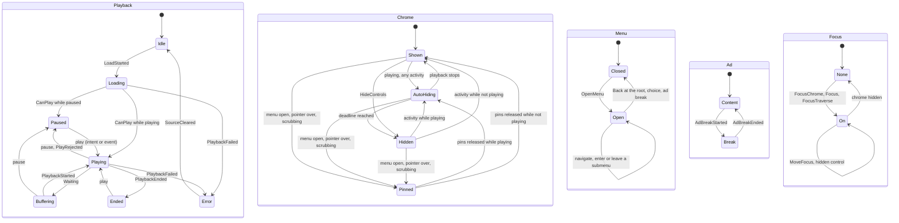

# Headless UI state machine

[ADR-0028](../adr/0028-headless-ui-state-machine.md) (D-28) chose a typed reducer over `std::variant` regions that
publishes frame-coalesced snapshots. This page documents the `umbra::ui` module that implements it (#97): the
regions, the order in which they reduce, timers, the ViewModel, the playhead, input, focus, accessibility, custom
controls and the prototype-gate results. Code comments are not used in Alumbra, so these rules live here.

The headers are in `umbra/ui/internal_include/umbra/ui/`. They use Abseil and the injected `TickClock`, so they are
not installed. The module depends on `umbra::base` and `penumbra::interface` only, and no renderer or platform code.

## Shape of the machine

```text
 renderer / engine / ads / app          UiMachine (one sequence)                       renderers
 ─────────────────────────────          ────────────────────────                       ─────────
 Intent ──────────┐
 EngineEvent ─────┤                      Normalize ─► region reducers ─► cross rules
 CatalogChange ───┼─► Dispatch(Input) ──►        (pure: Reduce)              │
 TimerFired ──────┘          │                                               ▼
                             │            UiState (immutable) ──► BuildViewModel ─► snapshot
                             ▼                                           │ at most one frame request
                      effects (sequenced)                                ▼ per frame
                      applied by a driver                        TakeSnapshot() at frame start
```

- `Reduce(previous, config, now, input)` is a pure function. It returns the next `UiState` and a list of `Effect`
  values. `UiMachine` reads the injected `TickClock`, sequences the effects and publishes the snapshot.
- Effects are values: `PlayerPlay`, `PlayerPause`, `PlayerSeek{position, precise}`, `PlayerSetVolume`,
  `PlayerSetMuted`, `RequestPresentation`, `StartTimer`, `BackToApp`, `CustomAction`, `MenuChoice` and
  `SkipAdRequested`. A thin driver applies them to the player (ADR-0023) and to the embedder's runner.
- The machine reads no system clock and uses no randomness.

## Regions

Each region is a `std::variant`, so it is never in two states at once and a state's data exists only in that state.

| Region | States |
|--------|--------|
| Playback | `Idle`, `Loading{spinner}`, `Playing`, `Paused`, `Buffering{spinner}`, `Ended`, `Error{code}` |
| Chrome | `Shown`, `AutoHiding{deadline}`, `Pinned{menu, pointer, scrub}`, `Hidden` |
| Menu | `Closed`, `Open{path, highlighted}` |
| Ad | `Content`, `Break{owner, skip}` |
| Presentation | `Inline`, `Fullscreen`, `PictureInPicture` |
| Scrub | `Idle`, `Scrubbing{fraction}` |
| Focus | `None{restore}`, `On{target, restore}` |

Facts that are not modes (the `paused` attribute, volume, mute, duration, the seekable window, buffered ranges, the
playback rate and resample ratio, and the playhead) live in `Media`.



The diagram is written by hand. Generating it from the variant alternatives at test time, as ADR-0028 describes,
is a follow-up.

## Order of reduction

`Reduce` runs these steps in this fixed order. Each region reducer reads the previous state of every region and the
already reduced state of the regions before it, and returns only its own region.

1. **Normalise.** Resolves what an intent means from the current state. A `Navigate` becomes a menu move, a slider
   adjustment, a focus move or a desktop shortcut. `Back` becomes `MenuBack`, `HideControls` or `PassBack`.
   `Activate{id}` becomes the control's own intent. An intent that targets a hidden or disabled control, a seek in
   an ad break, or any control input while an ad provider owns input is dropped here, so a hidden control cannot be
   activated by input or through the API.
2. **Catalogue:** custom controls and the menu tree.
3. **Media**, then **Playback**, **Ad**, **Scrub** and **Menu**.
4. **Ad rule.** An ad break closes the menu and ends a scrub.
5. **Menu rule.** A menu whose path or highlight no longer exists closes.
6. **Presentation.**
7. **Chrome.** Reads the menu, scrub and playback regions: an open menu or a scrub pins the chrome, and the chrome
   is not hidden while it is pinned.
8. **Focus.** Applies the focus intent, then hands focus to the nearest focusable control when the target stops being
   focusable, and clears focus when the chrome hides, keeping the target as the restore target. Focus moves to the
   skip control when it becomes available in an ad break.
9. **Playhead rule.** Rebases the playhead when the effective rate changes.
10. **Value rule.** Samples the slider value text and arms its timer while playing.
11. **Announcement rule.** Compares the previous and next state and queues announcements.

`CheckInvariants(state, config)` returns the violations of these invariants: no menu or scrub in an ad break; the
chrome is not hidden while a menu is open; the menu path and highlight exist; the chrome pins match the regions; the
playhead rate is the effective rate; the focus target is a visible, enabled, focusable control; every focus edge
names an existing focusable control; and ad mode shows none of the controls it hides. `UiMachine` asserts it in
debug builds, and the tests and the fuzz call it after every step.

## Timers

Timers are events. A reducer that needs a timeout allocates a generation number from `UiState::next_timer` and emits
`StartTimer{kind, generation, delay}`. The driver posts a delayed task to the embedder's runner, which feeds back
`TimerFired{kind, generation}`. The machine ignores a timer whose generation is not the one stored in the owning
region, so a timer that was overtaken (a short stall that resolved, an auto-hide that was extended) is harmless.

| Kind | Armed | On a valid fire |
|------|-------|-----------------|
| `kAutoHide` | The chrome starts auto-hiding. Activity moves the deadline and arms no new timer. | Hides the chrome, or re-arms for the remaining time when the deadline moved. |
| `kSpinner` | Entering `Loading` or `Buffering`. | Shows the spinner, so a stall shorter than `spinner_delay_ms` never flickers. |
| `kValueText` | Playback starts and after each fire. | Samples the seek slider's value text every 5 seconds, so a screen reader does not chatter. |

Tests use `Harness` (`test/umbra/ui/harness.h`), which applies `StartTimer` effects on a `FakeTickClock` and fires
them in order as the clock advances. Nothing sleeps.

## ViewModel and snapshots

`ViewModel` has six sections, each with a `version` that increases whenever the section changes: **controls**,
**menu**, **seek bar** (with the playhead), **focus** (target, restore target and the edges in each direction),
**announcements** and **modes** (the playback phase, the spinner, the error panel with its catalogue code, the
chrome, ad mode with its input owner and skip state, presentation, layout direction). It holds no display text.
Labels, value text and announcements are string keys with typed arguments.

- A step builds the next ViewModel and compares it with the published one. Nothing is published when nothing
  changed. When something changed, the machine calls the renderer's frame-request hook once, and the renderer calls
  `TakeSnapshot()` at the start of its next frame. Further changes before that call do not call the hook again.
- A snapshot is an immutable `shared_ptr<const ViewModel>`. A renderer may draw from it on its own render thread.
- Announcements are never dropped by coalescing. Each has a sequence number. An announcement that a taken snapshot
  carried is removed from later snapshots, and a renderer announces only sequence numbers it has not seen.
- Each field's `stable` or `experimental` label belongs in the sidecar reference, which the documentation task adds.

## Playhead

The seek bar section carries `Playhead{position_us, rate, anchor_us}`. The anchor is on the player's monotonic clock,
which `UiMachine::NowMicros()` exposes. A renderer draws `position + rate × (t − anchor)` clamped to the seekable
window, where `t` is the frame's target presentation time when the platform reports one.

The rate is the playback rate times the resample ratio of ADR-0024. It is zero while playback is not in `Playing`,
while a seek is outstanding and while the user scrubs. A new playhead is published only when extrapolation would go
wrong: on a rate change, a seek, a `Seeked`, a state change or a `TimeUpdate` that drifts by more than 150 ms. Steady
playback publishes nothing per `timeupdate`. The elapsed-time text is formatted by renderers from the playhead.

Scrubbing follows the ADR: the thumb follows the pointer from the scrub state in every frame, the engine receives the
latest position through a non-precise `PlayerSeek` with at most one outstanding (the next goes out on `Seeked`), and
`ScrubEnd` sends a precise seek.

## Input

Renderers normalise physical input into intents. The keyboard map is data in `keyboard_map.h`
(`kKeyboardMap`, `KeyToIntent`) and shared by every renderer.

| Key | Intent | Effect |
|-----|--------|--------|
| `Space`, `k`, `MediaPlayPause` | `TogglePlay` | Toggles at once and sends `PlayerPlay` or `PlayerPause` |
| `MediaPlay`, `MediaPause` | `Play`, `Pause` | |
| `j`, `l` | `SeekSteps(∓2)` | Seeks two steps (`ui.controls.seek_step_ms`) |
| `ArrowLeft`, `ArrowRight` | `Navigate` | Desktop: seek one step. TV: wake the chrome and move focus |
| `ArrowUp`, `ArrowDown` | `Navigate` | Desktop: volume by `ui.controls.volume_step`. TV: as above |
| `m` | `ToggleMute` | |
| `f` | `ToggleFullscreen` | Sends `RequestPresentation`; the engine confirms with `PresentationChanged` |
| `Enter` | `ActivateFocused` | Activates the focus target or the highlighted menu item |
| `Escape` | `Back` | Closes the menu (one level at a time), then hides the chrome, then `BackToApp` |
| `Tab`, `Shift+Tab` | `FocusTraverse` | Shows the chrome and moves focus through the controls |

The `c` shortcut (captions) waits for the caption menu (#140). Touch toggles the chrome with `ToggleControls`, and
double-tap seeking waits for its setting (#53). Pointer activity is `PointerActivity`, and `PointerEntered` and
`PointerLeft` pin the chrome while the pointer is over the controls.

## Focus

The machine's focus target is authoritative. The focus graph follows the order of slots: the seek bar above a row of
the leading controls and then the trailing controls.

- A focused **seek bar** consumes left and right (seek one step); down goes to the primary control.
- A focused **volume slider** consumes up and down (volume step); left and right move focus.
- Every other control moves focus left and right along the row, and up to the seek bar.
- With the menu open, directions navigate the menu. With no focus on desktop, directions are the shortcuts above. With
  no focus on TV, any direction wakes the chrome and focuses the restore target, or the play button if there is none.
- A focus change the platform makes itself arrives as `FocusControl{id}`. The machine accepts it for a focusable
  control and otherwise keeps its own target.

**Right-to-left.** ADR-0028 left open whether the seek bar and transport controls mirror. The rule, for every
renderer, is that the control bar does **not** mirror, following Material Design: time still runs left to right, and
the seek bar's left and right still mean back and forward. Menus **do** mirror: with `rtl` set, left enters a
submenu and right leaves it. `rtl` and the layout are in the modes section of the ViewModel.

## Accessibility

Controls carry an APG role (`button` or `slider`), a label key, value text and states.

- Seek and volume are sliders with a minimum, maximum and current value, plus value text
  (`value.time_of_total{elapsed_s, total_s}`, `value.live{behind_s}`, `value.percent{percent}`, `value.muted`).
- Settings is a menu button with `expanded`. Play and pause is one button whose label changes
  (`control.play`, `control.pause`). Mute and fullscreen are toggle buttons with a fixed label and a `pressed`
  state, so a control never changes both its label and its pressed state.
- Announcements cover discrete events only: `announce.play`, `announce.pause`, `announce.seeked{position_s}`,
  `announce.error{code}` (assertive) and `announce.ad_started`.

## Custom controls and settings

`RegisterControl{name, label_key, icon_token, slot}` adds a control of kind `custom` after the built-in controls of
its slot. It joins the focus graph and the accessibility model. `UpdateControl{name, visible, enabled, pressed}`
changes its state, and activating it emits `CustomAction{name}`. Ad mode hides custom controls.

`UiConfig` holds the settings until #53 adds the schema keys and the settings runtime (#54) is on `main`:

| Field | Planned key | Default |
|-------|-------------|---------|
| `auto_hide_ms` | `ui.controls.auto_hide_ms` | 3000 |
| `seek_step_ms` | `ui.controls.seek_step_ms` | 5000 |
| `volume_step` | `ui.controls.volume_step` | 0.05 |
| `spinner_delay_ms` | `ui.spinner.delay_ms` | 500 |
| `hidden_controls` | `ui.controls.hidden` | none |
| `control_order` | `ui.controls.order` | built-in order |

## Tests

`test/umbra/ui/` holds three suites and a benchmark.

- **Behaviour tests** cover auto-hide, the spinner delay, the error panel, scrubbing and the seek preview, the
  playhead, frame coalescing, section versions, announcements, menus, ad mode, focus, custom controls, the keyboard
  map and presentation.
- **Golden tests** replay a scripted scenario of intents, engine events and clock advances for each of 26 states and
  compare the effects and the final snapshot, as JSON, with `test/umbra/ui/golden/<scenario>.json`. A missing golden
  is written and the test fails, so review and commit the new file. To change one on purpose, delete it and rerun.
- **Intent fuzz.** Fixed seeds drive thousands of seeded intents, engine events, catalogue changes, timer events and
  clock advances through the machine and check the invariants after every step. A hidden or disabled control must
  never produce an effect. A failure reports its seed and the last twelve inputs; turn the sequence into a golden
  scenario.
- **`ui_benchmark`** measures one input followed by one snapshot.

Run them with `ctest --preset debug -R umbra_ui`.

## Prototype gate

| Measure | Result |
|---------|--------|
| Code size | 2,501 lines in `umbra/ui`; 75.6 KB of code (`__TEXT`, Release, Apple Clang, arm64) in `libumbra_ui.a` |
| Clean compile time of `umbra_ui` | 3.0 s wall, 12.5 s CPU for eight translation units (Release, `-j4`, on a heavily loaded machine) |
| One input followed by one snapshot (Release) | 2.1 to 2.5 µs for focus moves, playhead corrections and menu navigation (`ui_benchmark`, Apple M-series), about 0.06 % of the 4.2 ms budget; Debug is about 65 µs |

The budget is 4.2 ms, one 240 Hz frame. The benchmark shows no sign that entry and exit bookkeeping is getting
messy: the cross-region rules are short and their order is fixed, and the fuzz found no failure traced to a missed
entry or exit, so the typed reducer stays.

## Follow-ups

- The diagram generator, which builds the Mermaid page from the variant alternatives at test time and checks it for
  drift.
- The `ui.*` schema keys (#53) and their wiring to `UiConfig` once the settings runtime (#54) is on `main`.
- A driver that applies effects to the player (ADR-0023) and to the embedder's runner.
- The caption menu and its `c` shortcut (#140), the full ad region (#164), the settings panel (#160) and the
  presentation region's details (D-24).
- The seek bar's UI timeline, ad and cue markers (D-26).
- String catalogue, the sidecar field labels and the shared icon set.
- Playhead samples stamped with the monotonic time at which they were taken (#96, D-02).
