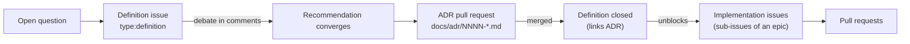

# How we work

Alumbra is planned and built in the open. This page explains how an idea becomes a decision, and a decision
becomes code.

## The flow



## Definitions

A **definition** is an open design question that is hard to reverse, crosses layers, or is user-visible. Each
definition issue:

- is titled `[D-NN] Topic` and labelled `type:definition` + `status:needs-discussion`;
- states **context**, **options**, **trade-offs**, a **recommendation**, and the **questions to settle**;
- is debated in comments until a decision is reached;
- closes when its ADR is merged, linking to it.

Implementation issues that depend on a definition are **blocked by** it, so the board shows what can start.

## Architecture Decision Records

ADRs live in [`docs/adr/`](adr/) and follow [`0000-template.md`](adr/0000-template.md). They are numbered,
immutable once accepted, and superseded (never edited) when a decision changes. See
[ADR-0001](adr/0001-record-architecture-decisions.md).

## Milestones, epics and issues

| Level | GitHub object | Example |
|-------|---------------|---------|
| Milestone | Milestone `M1 · First Light` | A demoable increment with exit criteria |
| Epic | Issue `type:epic` | `[M1] Desktop playback pipeline` |
| Work item | Sub-issue `type:feature` / `type:task` | `MP4/fMP4 demuxer` |
| Decision | Issue `type:definition` | `[D-05] Demux strategy` |

Every work item has **scope**, **acceptance criteria**, a **definition of done** and **references**.

### Definition of done (all work items)

- Code follows the Google C++ Style Guide and passes clang-format, clang-tidy and CI on all affected platforms.
- Unit tests (and conformance/golden tests where relevant) cover the change; parsers have fuzz targets.
- Public behaviour is documented; settings are added to the schema, never hard-coded.
- No new dependency without a licence entry (ADR-0010).
- Performance budgets are not regressed.

## Labels

| Prefix | Values | Purpose |
|--------|--------|---------|
| `type:` | `definition`, `epic`, `feature`, `task`, `bug`, `docs`, `research`, `chore` | What kind of issue |
| `layer:` | `umbra`, `penumbra`, `antumbra` | Which architectural layer |
| `area:` | `pipeline`, `network`, `hls`, `dash`, `abr`, `demux`, `decode`, `render`, `audio`, `text`, `ads`, `drm`, `ui`, `design`, `settings`, `api`, `build`, `ci`, `perf`, `testing`, `docs` | Functional area |
| `platform:` | `desktop`, `web`, `android`, `google-tv`, `ios`, `tvos` | Platform-specific work |
| `priority:` | `p0`, `p1`, `p2` | Must / should / could within its milestone |
| `status:` | `needs-discussion`, `blocked` | Workflow state not captured by the board |

GitHub's `good first issue`, `help wanted`, `duplicate` and `wontfix` are kept as well. Labels are declared in
[`.github/labels.yml`](../.github/labels.yml) and milestones are generated from the sections of
[`roadmap.md`](roadmap.md); both are applied with
[`scripts/github/sync_repo_metadata.py`](../scripts/github/sync_repo_metadata.py), so the repository never
drifts from the documents.

## The board

The **Alumbra Roadmap** GitHub Project tracks every issue with the fields *Status* (Backlog → Defining → Ready →
In progress → In review → Done), *Milestone*, *Layer*, *Platform*, *Priority* and *Size*, and has views for the
board, the roadmap by milestone, the definitions queue, and work by platform.

## Continuous integration

[`.github/workflows/ci.yml`](../.github/workflows/ci.yml) runs on every pull request (whatever its base branch,
so stacked pull requests are checked too), including edits that retarget the base branch, on every push to
`main` and on demand. Pull request runs share a per-PR concurrency group; push and manual runs have unique
groups so pending runs are not displaced.

[ADR-0021](adr/0021-testing-strategy.md) defines the testing strategy and the merge/release evidence
boundary. The table below describes implemented jobs, not its staged future gates. Missing assets,
calibrated thresholds or real-device/output results remain explicit evidence gaps, not passing checks.

| Job | What it does |
|-----|--------------|
| **Classify changes** | Lists the changed paths and decides whether the C++ matrix is needed ([`tools/ci/classify_changes.py`](../tools/ci/classify_changes.py)). |
| **Lint workflows** | Runs actionlint 1.7.12 (checksum-verified download), CI helper regression tests and YAML-based action pin checks ([`tools/ci/check_action_pins.py`](../tools/ci/check_action_pins.py)). |
| **Check C++ formatting** | Runs the pinned `scripts/format --check` over owned sources and prints diffs on failure. |
| **Check C++ lint and feature policy** | Builds `debug` with pinned Linux Clang, runs clang-tidy over every owned translation unit with `WarningsAsErrors: '*'`, and enforces the ADR-0013 feature policy. |
| **Validate settings** | Runs the stdlib-only TOML validator, base-revision compatibility checks, validator unit tests and deterministic parser fuzz smoke; always contributes to `ci-ok`. See [`settings/README.md`](../settings/README.md#validation). |
| **Linux x64 GCC 15**, **Linux x64 Clang 21**, **macOS arm64 Xcode 26.6** | Configure, build and test the `debug` and `release` presets, including the layering, C++ feature probe, installed-consumer and vcpkg manifest tests. |
| **Linux x64 Clang 21 ASan/UBSan**, **Linux x64 Clang 21 TSan**, **macOS arm64 Xcode 26.6 ASan/UBSan** | Run the complete CTest suite under each applicable sanitizer, verify instrumentation in Alumbra compile commands and dependency archives, and preserve the output of deliberately failing opt-in canaries. |
| **ci-ok** | Aggregates the others. It fails if any job failed or was cancelled, or if the C++ matrix was needed and any build, sanitizer, formatting or lint job did not succeed. |

The classify job also checks the committed error catalogue and its generator
tests with Python 3.11+, including documentation-only changes. This prevents
catalogue/SDK/reference drift from escaping the C++ path filter.

**Required check.** `ci-ok` is designed to be the always-present aggregate check. When the fail-closed classifier
marks a change as C++-relevant, it requires both the normal build matrix and every sanitizer leg to succeed. It
permits those jobs to skip only when the classifier marks every changed path as documentation. This preserves
ADR-0012's platform/path filtering; an unrelated web or documentation change does not start Apple builds. This
workflow does not configure branch protection or assert that a ruleset already requires the check. The coordinator
merge gate must require it; maintainers may also add it to the `main` ruleset when available.

Linux ASan enables leak detection. Apple's ASan runtime reports that
`detect_leaks` is unsupported, so that option is omitted on macOS.

**Path filter (ADR-0012).** The C++ matrix is skipped only when every changed path is documentation: `docs/**`
except `docs/cpp-features.md` (the C++ probes read it), top-level `*.md`, any `README.md`, `.github/ISSUE_TEMPLATE/**`,
`.github/pull_request_template.md`, `.github/labels.yml`, `.github/CODEOWNERS`, `LICENSE` and `NOTICE`. Any other
path, an empty diff or an event without a comparable base runs everything. Pull requests compare against their
base branch; pushes compare against the previous head. Renames classify both the deleted and added paths;
NUL-delimited Git output preserves literal Unicode, tab and newline filenames.

**Toolchains.** Runners are named explicitly, never `*-latest`. Linux uses `ubuntu-26.04` with `g++-15` and
`clang++-21` (libstdc++ 15) plus `nasm` for the x64 FFmpeg and dav1d builds. macOS uses `macos-26` (arm64) with
`DEVELOPER_DIR=/Applications/Xcode_26.6.app/Contents/Developer`, the ADR-0013 Xcode floor. Each job prints its
compiler, CMake, Ninja and runner image versions and publishes its C++ feature probe matrix in the job summary and
in the `reports-<leg>` artifact, together with the JUnit reports. The matrix describes that runner's toolchain only;
[`docs/cpp-features.md`](cpp-features.md) decides what is allowed.

**vcpkg.** Each job checks out `microsoft/vcpkg` at the manifest's `builtin-baseline` (read from `vcpkg.json`, so
the pin lives in one place), bootstraps it, and uses the `files` binary cache stored with `actions/cache`. The cache
key combines the leg, triplet, a hash of the compiler version (and Xcode version), the baseline and a hash of
`vcpkg.json` and the overlay triplets. Sanitizer triplets are distinct from the ordinary build triplets and from
each other; their cache keys cannot reuse unsanitized or differently instrumented binaries. Partial matches
remain scoped to the same sanitizer leg, and vcpkg reuses or rebuilds packages by ABI hash. The cache is saved
right after the first configure, so a later test failure does not discard a cold build.

**Other rules.** Default token permissions are `contents: read`, checkouts do not persist credentials, superseded
pull request runs are cancelled, and every job has a timeout.

**Pinned actions.** Every action is pinned to a full commit SHA. Workflow files carry no comments and this page
does not repeat the pins, so neither can go stale: the release behind a pin is recorded in the pull request that
set it, in Dependabot's title and description or in the author's description for a manual change. To resolve a
pin, `git log -S <sha> -- .github/workflows` finds the commit, and so the pull request, that introduced it, and
`gh api repos/<owner>/<repo>/tags --paginate --jq '.[] | select(.commit.sha == "<sha>") | .name'` lists the
upstream tags that point at it.

| Action | Used for |
|--------|----------|
| `actions/checkout` | Checking out Alumbra, and vcpkg at the manifest baseline, in CI and CodeQL. |
| `actions/cache/restore`, `actions/cache/save` | The vcpkg binary cache: CI restores and saves it; CodeQL only restores it. |
| `actions/upload-artifact` | Build, probe and sanitizer reports from the CI matrix. |
| `github/codeql-action/init`, `github/codeql-action/analyze` | CodeQL code scanning. |

actionlint is a release binary rather than an action. Its version and SHA-256 are set in the **Lint workflows**
job's environment (`ACTIONLINT_VERSION`, `ACTIONLINT_SHA256`), and Dependabot does not update it.

The pin checker parses YAML mapping keys with PyYAML 6.0.3 (MIT, CI-only), pinned in
[`tools/ci/requirements.txt`](../tools/ci/requirements.txt). It ignores names, comments and script scalar
text and unrelated `env`/`with` keys. It checks job and step action references (including composite action
steps), quoted/flow mappings, multiline values, anchors and merge keys, and fails on invalid YAML or
non-string action references. Remote actions and reusable workflows require a full commit SHA; Docker
actions require a SHA-256 digest; local actions are allowed. Dependency licensing is recorded in
[`THIRD_PARTY.md`](../THIRD_PARTY.md).

Run the focused checks locally in an isolated environment:

```sh
python3 -m venv .venv-ci
.venv-ci/bin/python -m pip install -r tools/ci/requirements.txt
.venv-ci/bin/python -m unittest discover -s tools/ci -p 'test_*.py'
.venv-ci/bin/python tools/ci/check_action_pins.py .github/workflows
actionlint
```

### Code scanning

[`.github/workflows/codeql.yml`](../.github/workflows/codeql.yml) runs CodeQL's advanced setup with the
`security-extended` query suite on every pull request, on every push to `main`, weekly on Monday at 03:41 UTC
and on demand. Results appear under the repository's code scanning alerts and on pull requests. Default token
permissions are `contents: read`; only the two analysis jobs add `security-events: write` to upload results.

| Job | What it analyses |
|-----|------------------|
| **Analyze workflows** | The `actions` language: every workflow under `.github/workflows`, without a build. |
| **Analyze C++** | The `c-cpp` language, built manually on `ubuntu-26.04` with GCC 15. |

The C++ job configures the `debug` preset with `ALUMBRA_BUILD_UI=ON` before CodeQL starts tracing, so vcpkg
dependencies are installed (or built) untraced. It also sets `CMAKE_CXX_SCAN_FOR_MODULES=OFF`: CMake's C++20
module scanning adds `-fmodules-ts` and `-fdeps-format=p1689r5` to every compile, CodeQL does not support
modules, and with those flags its extractor rejects every translation unit. Alumbra uses no modules. It then builds every target under the tracer: Umbra, the Penumbra
interface, the desktop port, the UI skeleton, the unit tests and the benchmarks. The `debug` preset is used rather
than `core`, because `core` omits the desktop port and the tests. The build directory lies outside the analysed
source root `src`. The headers vcpkg installs there are not part of the repository, but CodeQL still extracts and
analyses them with each source that includes them. Sources that only CTest compiles
are not analysed: the C++ feature probes, the deliberately invalid build fixtures and the installed-consumer link
probe. The sanitizer canaries, which contain deliberate defects, and the Clang-only libFuzzer target are not built
either.

The job restores, but never saves, the **Linux x64 GCC 15** leg's vcpkg binary cache, computing the same key from
the same compiler, triplet, baseline and manifest. A cold cache only makes the job slower. On pull requests it
reuses the CI change classifier and skips the C++ analysis when every changed path is documentation. Pushes,
scheduled and manual runs always analyse. Pull request runs use the default activity types, so retargeting a pull
request does not start an analysis until the next push.

### Dependency updates

[`.github/dependabot.yml`](../.github/dependabot.yml) checks for updates every Monday at 06:00 UTC. Each
ecosystem's updates are grouped into one pull request, labelled `type:chore` with `area:build` (vcpkg) or
`area:ci` (GitHub Actions). A seven-day cooldown keeps releases out of pull requests until they are a week old.

- **vcpkg** moves `builtin-baseline` to the full commit SHA of the newest vcpkg release tag. Dependabot cannot
  order an untagged baseline commit against release tags, so the configuration ignores tags dated on or before
  the current baseline commit (see [CONTRIBUTING](../CONTRIBUTING.md#dependencies-vcpkg) for raising that
  bound). The pull request runs the full CI matrix; review the licence of every changed port before merging.
- **GitHub Actions** replaces each full-SHA pin with the full commit SHA of the action's newest release, so
  pins stay immutable and pass the pin check. The pull request's title and description name the releases, which
  is the record of each pin (see **Pinned actions** above).
