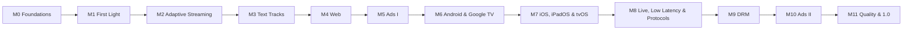

# Roadmap

Alumbra is delivered in milestones. Each is a demoable increment with **exit criteria** that must be verifiably
true before it closes. There are no dates: a milestone is done when its criteria are met.

Live progress is on the **Alumbra Roadmap** project board and in
[milestones](https://github.com/LuisAhumadaMartens/alumbra/milestones). Open design questions that gate each
milestone are listed as **definitions** (see [how we work](process.md)).

## M0 · Foundations

The skeleton every later milestone builds on.

- CMake presets build Umbra and the desktop Penumbra port on macOS and Linux with vcpkg-managed dependencies.
- CI runs build, unit tests, clang-format, clang-tidy, and ASan/UBSan/TSan on every pull request.
- The settings schema and design-token pipelines generate code from a single source and fail CI on drift.
- The documentation site publishes from `main`.
- **Gating definitions:** D-01 threading, D-04 Penumbra contract, D-07 settings schema, D-09 errors, D-29 tokens,
  D-30 observability, D-31 testing, D-32 dependencies, D-33 docs tooling.

## M1 · First Light

Play a local or HTTP file on desktop, correctly.

- `alumbra-cli <url>` plays progressive MP4, MPEG-TS and WebM/MKV over `file://` and `http(s)://`.
- Software decode of H.264, HEVC, VP9, AV1, AAC, Opus, AC-3, FLAC and MP3.
- A/V sync stays within the D-02 tolerance over a 10-minute conformance clip; seeking is frame-accurate.
- The HTMLMediaElement-shaped API (`play`, `pause`, `currentTime`, `duration`, `readyState`, events, `MediaError`)
  passes its conformance tests.
- A minimal desktop UI renders from the headless UI state machine and design tokens.
- **Gating definitions:** D-02 clock, D-03 API, D-05 demux, D-06 decode, D-08 network, D-19 desktop, D-28 UI state,
  D-35 Windows.

## M2 · Adaptive Streaming

HLS and DASH, VOD and live, with ABR.

- HLS: master/media playlists, TS and fMP4/CMAF segments, AES-128, alternate audio, discontinuities, live sliding
  window.
- DASH: SegmentTemplate (`$Number$`/`$Time$`), SegmentTimeline, SegmentBase, multi-period, live (`type=dynamic`).
- Both map onto one unified presentation model; ABR switches renditions without stalls on the conformance set.
- Buffer limits come from settings and are respected under memory pressure.
- **Gating definitions:** D-10 manifest model, D-11 ABR, D-12 buffer.

## M3 · Text Tracks

Every common subtitle format, styled by settings.

- WebVTT (sidecar, in HLS, in MP4), SubRip, ASS/SSA (via libass), TTML/IMSC1 and CEA-608/708 render correctly
  against golden frames.
- User caption styling (size, colour, background, edge, position) is driven by settings and honours platform
  accessibility preferences where available.
- **Gating definitions:** D-15 cue model.

## M4 · Web

Umbra in the browser.

- Emscripten build of Umbra; Penumbra web backend with MSE output and WebCodecs + WebGL fallback chosen per stream.
- `<alumbra-player>` web component and TypeScript SDK, packaged for npm as `alumbra` (`npm i alumbra`). When it is
  first published is part of D-34.
- GitHub Pages demo (URL box, settings panel, stats overlay) and the live design-token playground.
- The web build targets every device with a browser. It passes the web conformance set on current Chrome,
  Firefox, Safari and Edge on desktop, Safari on iPhone and iPad, and Chrome on Android. TV-class browsers are
  tested as chosen in D-22.
- **Gating definitions:** D-16 MSE vs WebCodecs, D-17 WASM threading, D-18 bindings, D-22 compatibility, D-24
  fullscreen, D-34 release (package names and first publish).

## M5 · Ads I

Client-side ads that never break the player.

- Vendor-neutral AdManager with pre-, mid- and post-rolls from VMAP/VAST 4.
- Built-in VAST/VMAP provider on desktop; IMA HTML5 provider on web.
- Layering and input-ownership contract: the ad UI is never masked by player chrome. On the web, where IMA HTML5
  has no friendly-obstruction API, no player UI is drawn over the ad container; on native platforms, controls shown
  during ads are registered as OMID friendly obstructions.
- Styled fullscreen during ad breaks, including CSS pseudo-fullscreen on iPhone Safari.
- **Gating definitions:** D-23 ad layering, D-24 fullscreen, D-25 IMA surface.

## M6 · Android & Google TV

- Penumbra Android backend: MediaCodec, AudioTrack, Surface rendering (tunneled where supported).
- Kotlin SDK, Compose renderer, D-pad focus navigation on Google TV; IMA Android provider.
- Sample apps for phone and TV pass the Android conformance set on emulators and a reference device.
- **Gating definitions:** D-18 bindings, D-21 Android rendering.

## M7 · iOS, iPadOS & tvOS

- Penumbra Apple backend per D-20; Swift SDK; SwiftUI renderer; focus engine on tvOS.
- Picture in Picture and AirPlay (video handoff through the AVPlayer capability built in M7, plus audio and
  mirroring); IMA iOS/tvOS provider.
- Sample apps pass the Apple conformance set on simulators and a reference device.
- **Gating definitions:** D-20 Apple path.

## M8 · Live, Low Latency & Protocols

- LL-HLS (partial segments, preload hints, blocking playlist reload) and LL-DASH (chunked CMAF) at target latency.
- Latency catch-up via playback rate; DVR window and seek-to-live.
- `rtmp://`, `rtsp://`, `srt://` and `udp://` sources on native platforms.
- **Gating definitions:** D-13 live model, D-14 protocols.

## M9 · DRM

- CENC ClearKey (`cenc` and `cbcs`) end-to-end; EME on web; Widevine via MediaDrm; FairPlay on Apple; PlayReady
  where available.
- An EME-shaped key-system API, identical across platforms.
- **Gating definitions:** D-27 CDM abstraction.

## M10 · Ads II

- IMA DAI (SSAI): stream-time ↔ content-time mapping, ad-aware seeking and snapback.
- SGAI via HLS interstitials (`EXT-X-DATERANGE CLASS="com.apple.hls.interstitial"`) and the DASH equivalent.
- **Gating definitions:** D-26 DAI/SGAI timeline.

## M11 · Quality & 1.0

- HDR10 and HLG output where the platform supports it.
- Performance budgets enforced in CI: time-to-first-frame, memory on 1 GB-class devices, dropped frames.
- Perfetto tracing; continuous fuzzing of every parser; full conformance suite green on every platform.
- Accessibility audit of every UI renderer; documentation complete; release artefacts per D-34.
- **Gating definitions:** D-34 release.
